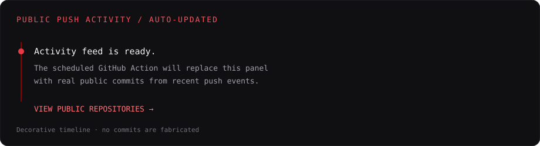

# Hi, I'm Md Kamran 👋

<p align="center"></p>

<p align="center"></p>

<p align="center">
<a href="https://md-kamran400.github.io/"></a>
<a href="https://linkedin.com/in/md-kamran-757bb0250"></a>
<a href="mailto:ka5452488@gmail.com"></a>
</p>

<p align="center"></p>

---

## &gt; WHO AM I?

```text
$ whoami
Md Kamran — Full Stack Developer, India

$ role
Building practical, responsive full-stack web applications

$ currently_building
Scalable web applications and database-driven systems
```

I build full-stack applications and enjoy solving real-world problems with clean, useful software. I work primarily with **React and Node.js**, developing scalable APIs and database-driven systems, and I’m always learning new technologies and improving how I build.

<p></p>

- 💼 Full Stack Developer at [RaiseMatters](https://raisematters.com/)
- 📄 [Resume](https://drive.google.com/file/d/1SebqJdvcHe3_R-JEreersd6q4JapbB_I/view?usp=sharing)

## &gt; CURRENT FOCUS

Building useful web products, full-stack workflows, production and operations software, authentication and role-based access, reliable APIs, and thoughtful AI integrations.

## &gt; DEVELOPER TOOLKIT

**FRONTEND**  
       

**BACKEND**  
  

**DATABASE**  
  

**TOOLS**  
    

**AI & EXPLORATION**  
  

## &gt; GITHUB CONTRIBUTION DASHBOARD

<p align="center"></p>

## &gt; CONTRIBUTION SNAKE

<p align="center"></p>

## &gt; RECENT DEVELOPMENT ACTIVITY

<p align="center"><a href="https://github.com/md-kamran400?tab=overview"></a></p>

The feed is designed to use actual public GitHub push events through a scheduled workflow; GitHub only exposes a limited recent public-event window.

## &gt; SELECTED PROJECTS

| Project | What it is | Stack / links |
| --- | --- | --- |
| [**Outfitter**](https://github.com/md-kamran400/outfitter) | Full-stack ecommerce app with user authentication and clothing purchases. | React · Node.js · Express · MongoDB · [Live demo](https://outfitter-frontend-xz3u.vercel.app/) |
| [**Regenato**](https://github.com/md-kamran400/regenato_web_app) | Web application with live deployment; separate frontend and backend repositories also exist. | JavaScript · [Live demo](https://regenato-web-app.vercel.app/) |
| [**HyperGro**](https://github.com/md-kamran400/HyperGro) | TypeScript video-clone application with pagination. | TypeScript · React · [Live demo](https://vercle-hypergro.vercel.app/) |
| [**Portfolio**](https://github.com/md-kamran400/md-kamran400.github.io) | My personal portfolio site. | TypeScript · [Visit portfolio](https://md-kamran400.github.io/) |

## &gt; GITHUB STATS

<p align="center">


</p>

*Third-party statistic cards may be cached or temporarily unavailable.*

## &gt; DEVELOPER TERMINAL

<p><sub>Decorative terminal — commands are illustrative, not executed.</sub></p>

```text
$ git status
✓ Working tree clean

$ npm run build
✓ Build completed

$ developer --info
Building digital experiences.
Solving real-world problems.
Learning every day.
```

## &gt; CONNECT WITH ME

<p align="center">
<a href="https://github.com/md-kamran400"></a>
<a href="https://md-kamran400.github.io/"></a>
<a href="https://linkedin.com/in/md-kamran-757bb0250"></a>
<a href="mailto:ka5452488@gmail.com"></a>
</p>

<p align="center"><strong>LET'S BUILD SOMETHING GREAT.</strong></p>
<p align="center"><sub>Designed in charcoal & crimson · Built to stay focused on the work</sub></p>
